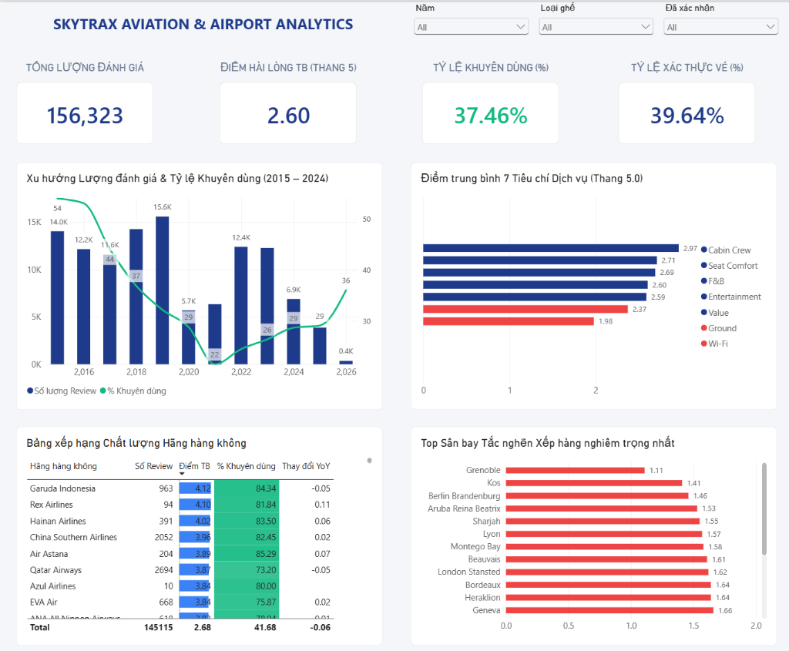
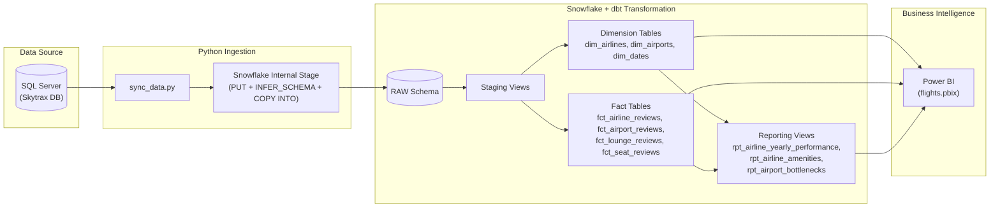

# Skytrax Aviation and Airport Customer Experience Analytics

## 1. Project Overview
This project builds an end-to-end ELT (Extract, Load, Transform) data pipeline and Business Intelligence solution to analyze customer satisfaction across the global commercial aviation industry. Using historical passenger review data from Skytrax (`156,323` airline reviews and `49,505` airport reviews across `595` airlines and `1,004` airports), the pipeline extracts raw relational data from SQL Server, loads it into Snowflake Data Warehouse, transforms it into a Kimball Star Schema using dbt (data build tool), and serves analytical marts to Microsoft Power BI.

### Objectives
- Automate data extraction and batch loading from a relational source database (SQL Server) to a cloud data warehouse (Snowflake).
- Design a dimensional data model (`staging`, `dimensions`, `facts`, and `reporting` marts) that handles missing values accurately without introducing downward statistical bias for unrated optional services.
- Evaluate key service drivers behind passenger net recommendation rates, year-over-year airline rating changes, and airport queuing bottlenecks.

---

## 2. Dashboard Preview



---

## 3. System Architecture and Tech Stack

| Layer | Technology | Role in Pipeline |
| :--- | :--- | :--- |
| **Data Source** | Microsoft SQL Server | Stores raw operational tables (`skytrax` schema). |
| **Ingestion (EL)** | Python (`pandas`, `pytds`, `snowflake-connector`) | Sanitizes newline characters, exports batched CSVs, uploads to Snowflake Internal Stage (`PUT`), infers schema (`INFER_SCHEMA`), and executes bulk load (`COPY INTO`). |
| **Storage (DW)** | Snowflake | Cloud data warehouse hosting `RAW`, `STAGING`, `MARTS`, and `REPORTING` schemas inside `FLIGHTS_DW`. |
| **Transformation (T)** | dbt Core (`dbt-snowflake`, `dbt_utils`) | Manages SQL modeling, lineage, window-function aggregations, and 30 automated schema/data quality tests. |
| **BI & Serving** | Microsoft Power BI | Connects to Snowflake marts to visualize KPIs, service trends, and operational bottlenecks. |



---

## 4. Data Modeling and Methodology

The warehouse transformation inside `transform/models/` follows a three-tier Kimball architecture:

1. **Staging Layer (`models/staging/`):**
   - Standardizes column names, trims whitespace, casts date/boolean fields, and converts `0` or empty ratings to `NULL` via `NULLIF(score, 0)`.
   - **Handling Missing Data:** Passengers frequently leave optional categories unrated (e.g., `wifi_and_connectivity` or `food_and_beverages` on short-haul and low-cost flights). Converting unrated values to `0` artificially depresses an airline's composite score. Preserving `NULL` in the staging layer ensures statistical accuracy in downstream aggregations.

2. **Core Marts Layer (`models/marts/dimensions/` and `models/marts/facts/`):**
   - **Dimensions:** `dim_airlines`, `dim_airports`, and `dim_dates` (generated from `2010-01-01` to `2030-12-31` via `dbt_utils.date_spine`).
   - **Facts:** `fct_airline_reviews`, `fct_airport_reviews`, `fct_lounge_reviews`, and `fct_seat_reviews`. Each fact table computes a row-level dynamic composite score (`overall_review_score`, `overall_airport_score`, etc.) by dividing the sum of rated criteria by the exact count of non-null criteria rated by that passenger.

3. **Reporting Layer (`models/marts/reporting/`):**
   - `rpt_airline_yearly_performance`: Aggregates annual review volume, average scores, net recommendation rates, annual rankings (`RANK()`), and year-over-year deltas (`LAG()`) for airlines with at least 10 reviews per year.
   - `rpt_airline_amenities`: Joins aggregated seat comfort metrics and airport lounge hospitality scores per carrier.
   - `rpt_airport_bottlenecks`: Identifies international airports with the lowest queuing and security throughput ratings (`HAVING COUNT(review_id) > 20`).

---

## 5. Key Findings from the Dataset

- **Overall Satisfaction and Post-Pandemic Trend:** Across `156,323` airline reviews, the global average satisfaction score is `2.60 / 5.00` with a net recommendation rate of `37.46%` (reflecting negative review self-selection common on public aviation portals). Recommendation rates fell from `51.9%` in 2016 to a trough of `17.6%` in 2021 during COVID-19 travel restrictions, recovering to `25.6%`–`36.0%` between 2024 and 2026.
- **In-Flight Touchpoint Breakdown:** Passengers rate **Cabin Staff Service (`2.97 / 5.00`)** and **Seat Comfort (`2.71 / 5.00`)** highest, whereas **Wi-Fi & Connectivity (`1.98 / 5.00`)** and **Ground Service (`2.37 / 5.00`)** consistently score lowest across all carriers.
- **Carrier Rankings:** Full-service Asian carriers lead long-term customer satisfaction among airlines with significant review volume (`Garuda Indonesia` at `4.12 / 5.00`, `Hainan Airlines` at `4.02 / 5.00`, `China Southern Airlines` at `3.95 / 5.00`, and `Qatar Airways` at `3.87 / 5.00`).
- **Airport Queuing Impact:** Analysis of `49,505` airport reviews reveals that severe queuing bottlenecks (`avg_queuing_score < 1.65 / 5.00` at hubs such as `Grenoble`, `Berlin Brandenburg`, `Lyon`, and `London Stansted`) pull overall airport recommendation rates down below `10%`.

---

## 6. Repository Structure

```text
flight-analytics-dbt/
├── .github/
│   └── workflows/
│       └── ci.yml
├── dashboard/
│   └── flights.pbix
├── docs/
│   └── dashboard_preview.png
├── ingestion/
│   └── sync_data.py
├── scripts/
│   └── setup.sh
├── transform/
│   ├── models/
│   │   ├── staging/
│   │   │   ├── sources.yml
│   │   │   ├── stg_airline_reviews.sql
│   │   │   ├── stg_airlines.sql
│   │   │   ├── stg_airport_reviews.sql
│   │   │   ├── stg_airports.sql
│   │   │   ├── stg_lounge_reviews.sql
│   │   │   └── stg_seat_reviews.sql
│   │   └── marts/
│   │       ├── dimensions/
│   │       │   ├── dim_airlines.sql
│   │       │   ├── dim_airports.sql
│   │       │   └── dim_dates.sql
│   │       ├── facts/
│   │       │   ├── fct_airline_reviews.sql
│   │       │   ├── fct_airport_reviews.sql
│   │       │   ├── fct_lounge_reviews.sql
│   │       │   └── fct_seat_reviews.sql
│   │       ├── reporting/
│   │       │   ├── rpt_airline_amenities.sql
│   │       │   ├── rpt_airline_yearly_performance.sql
│   │       │   └── rpt_airport_bottlenecks.sql
│   │       └── schema.yml
│   ├── dbt_project.yml
│   ├── package-lock.yml
│   └── packages.yml
├── .env.example
├── .gitignore
├── Makefile
├── README.md
├── requirements.txt
└── run_pipeline.sh
```

---

## 7. Setup and Execution

### Prerequisites
- Python 3.10+
- Access to a Snowflake account and source SQL Server instance
- Microsoft Power BI Desktop

### 1. Environment Configuration
Clone the repository, install dependencies, and create a `.env` file from `.env.example`:

```bash
git clone <repository-url>
cd flight-analytics-dbt
cp .env.example .env
```

Update `.env` with your SQL Server and Snowflake credentials.

### 2. Run the Pipeline
Using Bash / Git Bash:
```bash
./scripts/setup.sh
./run_pipeline.sh all
```

Or using Make:
```bash
make setup
make all
```

### 3. Refresh Power BI Report
Open `dashboard/flights.pbix` in Power BI Desktop and click **Refresh** to query the updated Snowflake tables.
